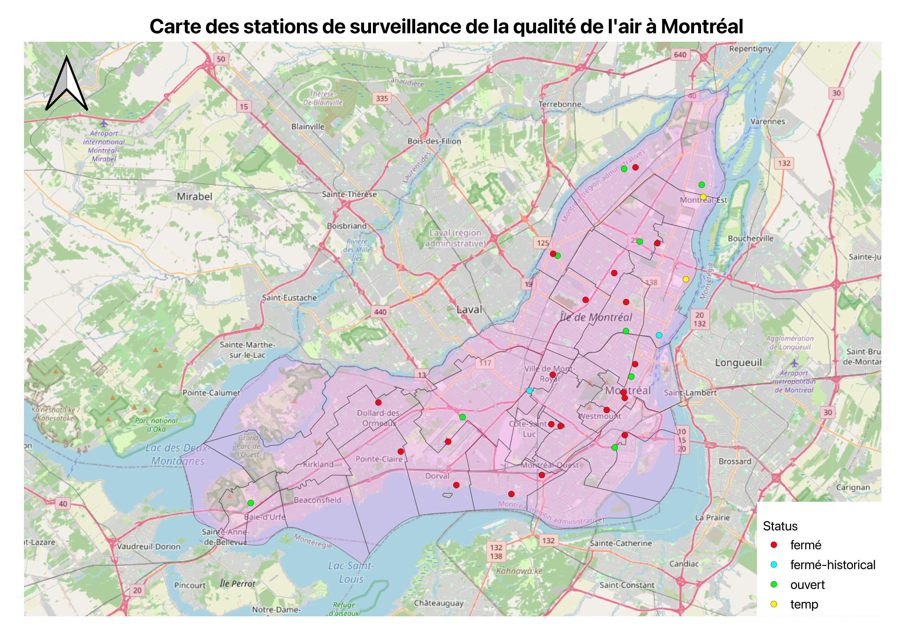
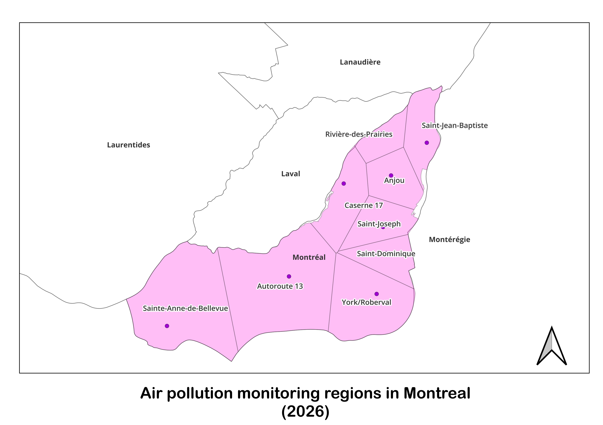

# Montréal Air Quality Analysis

A data science project developed in collaboration with **Concordia University
(Montréal)**, exploring air quality in the city using open RSQA data combined
with atmospheric variables. Results — predictions and a heatmap — are
visualized in the **CityLayers** platform (NGCI, Concordia).

## Overview

The project processes, cleans and organizes air quality monitoring data,
analyzes atmospheric pollutants, identifies temporal patterns and trends, and
builds a prediction model. The outputs are a pollutant prediction model and an
interactive heatmap displayed in CityLayers alongside those predictions.

## Workflow

1. **Data cleaning and treatment** — classify, clean and validate the raw data
   before any analysis.
2. **Prediction model** — train a model on the cleaned data.
3. **Heatmap** — spatial visualization of air quality, shown in CityLayers
   together with the predictions.

## Data

**Air quality (RSQA)**
- **RSQA – Multi-Polluants (en continu)** (2013–2025) — gaseous pollutants
  (NO2, O3) and particulate matter (PM2.5), continuous measurements.
  https://donnees.montreal.ca/fr/dataset/rsqa-polluants-gazeux
- **Station list** (`liste-des-stations_do_rev_2026-05-22.csv`) — station
  metadata: location, status and monitoring region.
  https://donnees.montreal.ca/fr/dataset/rsqa-liste-des-stations

**Atmospheric variables**
- **CHIRPS / CHIRTS** (Climate Hazards Center, UC Santa Barbara)
  https://swat.tamu.edu/data/chirps-chirts/
- **NASA POWER** (NASA Langley Research Center)
  https://power.larc.nasa.gov/data-access-viewer/

**Deliberately excluded:** the *RSQA – Indice de la qualité de l'air
(historique)* dataset. It is a derived, aggregated product rather than raw
measurement data; using it as a label or feature would introduce data leakage
and hide the underlying pollutant values the model is meant to learn from. It
may still be used later as an external validation reference.

## Monitoring Network

*Monitoring stations across the Montréal agglomeration, by status: closed
(fermé), historically closed (fermé-historique), open (ouvert) and
temperature-only (temp).*

*Air pollution monitoring regions of the agglomeration (2026), with the
representative station of each region.*

## State of the Art

The methodological framework is grounded in the following selected references:

- **Rowland et al. (2024)** — analysis of atmospheric variables and their
  relationship with air pollutants: temperature, wind, rainfall, temporal
  patterns and thermal inversions.
- Two additional Spanish-language studies on atmospheric variables and
  pollutant behaviour, selected from Google Scholar.

**Regulatory references for day classification**
- **IQA (Indice de la qualité de l'air, Québec – MELCCFP):** per-pollutant
    sub-index = concentration / reference value × 50, with categories
  Bon (1–25), Acceptable (26–50) and Mauvais (51+). Reference values:
  O3 82 ppb, PM2.5 35 µg/m³, NO2 213 ppb.
- **AQHI (Canada):** composite index combining the three pollutants. Note that
  Québec uses Info-Smog instead of AQHI.

## Focus

The project is split into two complementary modelling tracks, agreed by the
working team in the first session.

### Air pollution model

The current task is to classify days as "good" or "bad" based on NO2, O3 and
PM2.5 concentrations, grounded in the literature and official standards above.
The database is being cleaned and prepared before the model is built.

### Atmospheric conditions model

The atmospheric variables feeding the model are: precipitation, maximum and
minimum temperature, relative humidity, solar radiation, wind speed and
atmospheric pressure.

**Data sourcing status and open issues**

- Most available weather databases lack fine spatial resolution: some provide
  only a single point for the whole of Montréal.
- **CHIRPS / CHIRTS** offers a useful grid for precipitation and maximum and
  minimum temperature, but the data are not measured in situ and may not
  accurately reflect actual weather conditions. They are kept as an option,
  with this limitation in mind.
- Two candidate databases are being obtained through **Saeed (NGCI)**:
  - a database generated from a calibrated model;
  - a **Hydro-Québec** database of measured atmospheric data — its main
    limitation is its time span (2021–2025), while the air pollution data run
    from January 2013 to December 2025.
- Both are pending delivery and will be explored for suitability before being
  integrated.

## Visualization

Predictions and the heatmap are integrated into CityLayers:
https://ngci.encs.concordia.ca/citylayers/login

## Status

Work in progress — data cleaning and validation first, then modeling and
visualization.